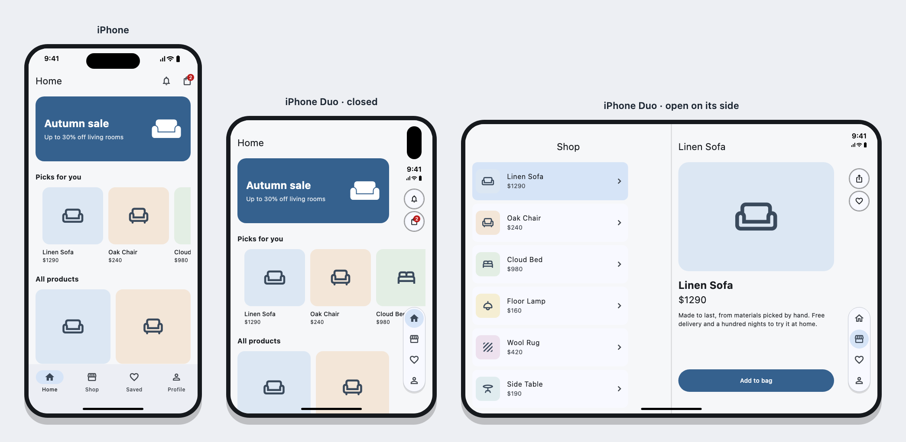
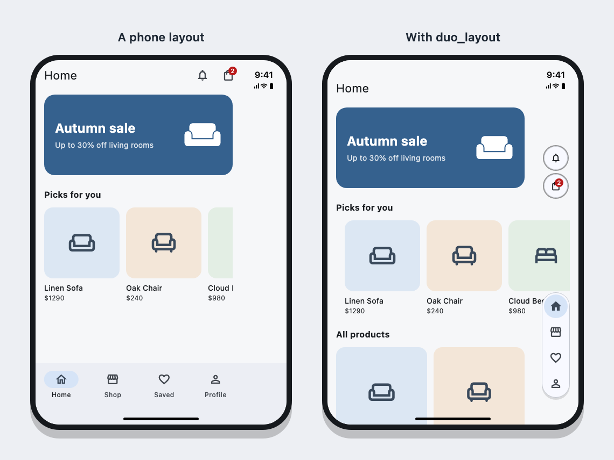
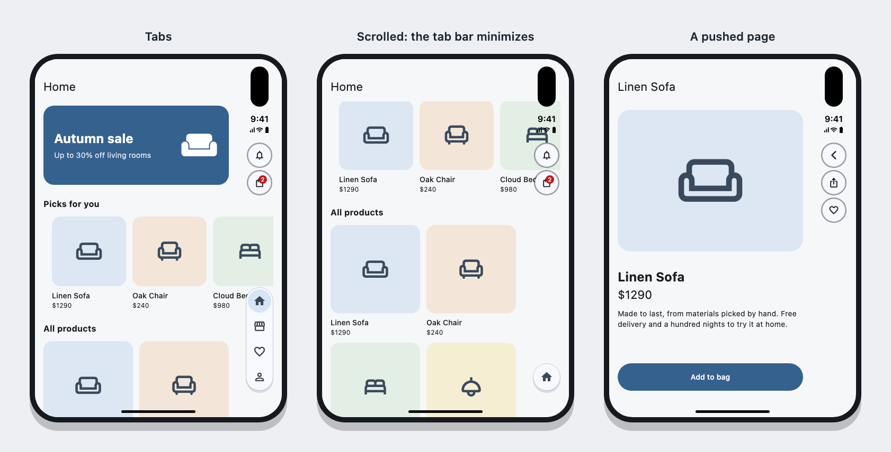
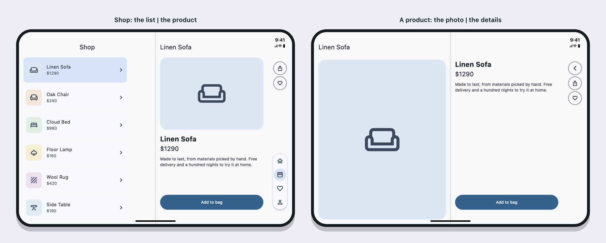
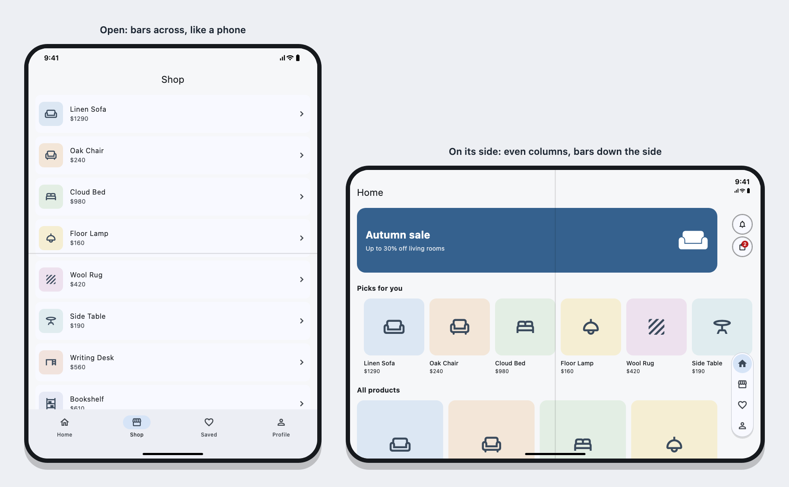

# duo_layout

**iPhone Duo layouts for Flutter, drawn the way Apple's Human Interface
Guidelines draw them.**

Add one widget to your app and swap a few others. On the iPhone Duo your app
then behaves like Apple's own apps:

- The tab bar stands down the side of the screen and minimizes when you scroll.
- Back and the toolbar buttons stand in the status bar's column, under the clock.
- Two panes split exactly at the fold.
- Horizontal rows of cards scroll all the way to the edge of the glass.

On an iPhone, an iPad and Android, the same code draws the app you have
today. Nothing changes there.



## Contents

- [The problem](#the-problem)
- [Features](#features)
- [Install](#install)
- [Quick start](#quick-start)
- [Moving an existing app over](#moving-an-existing-app-over)
- [Widgets](#widgets): [`DuoScope`](#duoscope) ·
  [`SideTabBar`](#sidetabbar) · [`DuoAppBar`](#duoappbar) ·
  [`SideToolbar`](#sidetoolbar) · [`TwoPane`](#twopane) ·
  [`ListDetail`](#listdetail) · [`DialogOffFold`](#dialogofffold) ·
  [`FoldSplit`](#foldsplit) · [`EdgeBleed`](#edgebleed)
- [Reading the device](#reading-the-device): the hinge, the fold, the
  posture
- [Helpers](#helpers): `context.barEdge`, window classes, even columns
- [With `flutter_screenutil`](#with-flutter_screenutil)
- [Testing your layouts](#testing-your-layouts)
- [How it works](#how-it-works)
- [Apple's rules this follows](#apples-rules-this-follows)
- [FAQ](#faq)
- [Limits](#limits)
- [Example app](#example-app)
- [Roadmap](#roadmap)

## The problem

The iPhone Duo folds like a book. It has two screens:

| Screen | Size (points) | Where the status bar is |
|---|---|---|
| Outer (closed) | 466 × 678 | Down the right side, in an 84-point column |
| Inner, held upright | 669 × 951 | Along the top, like any phone |
| Inner, on its side | 951 × 669 | Down the right side, in an 84-point column |

So on the outer screen, and on the inner one held on its side, the status bar
is **a column down the side** instead of a strip along the top. An app built
for a phone doesn't know that:



| A phone layout | With duo_layout |
|---|---|
| An empty column takes 18% of the width | The column holds the toolbar and the tabs, as in iOS |
| A bottom tab bar eats into an already short screen | The tabs float in a capsule down the side |
| The bell and the bag squeeze in beside the clock | The buttons stand under the clock, where Apple puts them |
| A row of cards stops in a straight line mid-screen | The row scrolls to the edge of the glass |

And there are problems you can't see in that picture:

- **The open Duo stays locked upright.** iOS keeps reporting the outer
  screen's size while the Duo is open. Code that locks phones to portrait
  locks the open Duo too.
- **`Info.plist` blocks it as well.** The Duo is an iPhone. If the iPhone's
  orientations list only portrait, iOS never lets the open Duo turn, whatever
  your code asks for.
- **With `flutter_screenutil`, everything is 15% too big** on the outer
  screen. It scales by the whole 466-point width, not the 382 points beside
  the column.
- **Content lands on the fold.** A three-column grid puts its middle card
  right on the crease.
- **Headers hit the rounded corner.** With the status bar down the side, iOS
  reports no top inset at all.
- **Flutter passes on nothing iOS knows about the Duo:** no hinge, no fold,
  no column. iOS 27.1 has the APIs, but only native code can call them. This
  package's iOS plugin calls them for you.

## Features

- **One line of setup.** Wrap your app in `DuoScope`, and every widget below
  adapts by itself.
- **It asks iOS.** A small iOS plugin reads iOS 27.1's own APIs: which side
  the status bar's column is on, the hinge angle, and where the fold and the
  camera are. Before iOS 27.1, and off iOS, it falls back to reading the safe
  area, so nothing breaks.
- **Half-open postures.** `DuoDevice.of(context).posture` tells you when the
  Duo is held like a book or stood on a table, so you can lay out around the
  bend.
- **No `if (isDuo)` in your screens.** `DuoAppBar` is a plain `AppBar` on a
  phone and moves its buttons to the column on the Duo. `SideTabBar` is just
  its child when there's no column. You write each screen once.
- **The tab bar Apple asks for.** A capsule of icons at the foot of the
  column. It shrinks to the current tab when you scroll down, and opens again
  when you scroll up or tap it.
- **A toolbar in the column.** Back (or Close on a full-screen dialog) on
  top, your actions under it. The buttons belong to their screen: they hide
  when it's covered or its tab isn't showing, and fade with the route.
- **Two panes at the fold.** `TwoPane` splits exactly where iOS says the
  fold is. Each pane is about a phone wide, and the crease cuts nothing. On
  an iPad it's simply half and half.
- **List and detail, like Mail.** `ListDetail` opens an item beside its list
  on the open Duo and on its own page on a phone. Fold the Duo shut and the
  item you were reading goes on to its own page; the list keeps its scroll.
- **Dialogs off the fold.** `DialogOffFold` keeps a dialog to one half, the
  way Apple asks.
- **Side-by-side comparisons.** `FoldSplit` and `FoldRow` put two things one
  either side of the fold, as wide as each other.
- **Rows that reach the glass.** `EdgeBleed` lets a horizontal row scroll
  under the column to the edge of the screen. Its first card still lines up
  with the page's text.
- **Even columns.** `DuoBreakpoints.columns(..., even: true)` gives an even
  number of grid columns, so the fold falls between two cards.
- **Orientation that works.** Phones stay upright; tablets and the open Duo
  turn every way. The lock follows the device as it opens and closes.
- **Right to left done right.** In Arabic or Hebrew the column stays on the
  same physical side of the glass, as Apple asks. The content mirrors, and in
  `TwoPane` the panes swap.
- **Accessible.** Icon-only tabs and buttons still carry labels and tooltips
  for screen readers. Tap targets are 44 points, Apple's minimum. Animations
  are skipped when the system asks for reduced motion.
- **Themed by default.** Colours come from your `ColorScheme`, and every
  size, colour and timing can be overridden.
- **Works with `flutter_screenutil`**, or without it. `DuoDesignSize` gives
  the right `designSize` for every window.
- **No dependencies** beyond Flutter.
- **Tested.** 43 tests, and an example app to try on the simulator.

## Install

The repository is private, so you need read access to it on GitHub. So does
anyone, or any CI, that builds your app.

```yaml
dependencies:
  duo_layout:
    git:
      url: https://github.com/AbdulrahmanElsehemi/duo_layout.git
      ref: v0.3.0
```

Then run `flutter pub get`, and `pod install` in `ios/` if your app uses
CocoaPods.

Pin `ref` to a tag, not a branch. Then a new commit never changes your app
until you move the tag yourself.

It needs Flutter 3.44 or later.

The hinge, the fold and the camera regions come from the iOS 27.1 SDK, so
build with Xcode 27.1 or later to get them. An app built with an older Xcode
still builds and runs: the plugin answers that it knows nothing, and the
package reads the safe area instead.

## Quick start

**1. Put `DuoScope` above the navigator,** in `MaterialApp.builder`:

```dart
import 'package:duo_layout/duo_layout.dart';

MaterialApp(
  builder: (context, child) => DuoScope(child: child!),
  home: const Shell(),
)
```

If your app already has a builder, make `DuoScope` the outermost widget in
it. It works the same with `MaterialApp.router`.

**2. Allow landscape in `ios/Runner/Info.plist`.** iOS combines this list with
what your app asks for. With portrait only, the open Duo can never turn.

```xml
<key>UISupportedInterfaceOrientations</key>
<array>
    <string>UIInterfaceOrientationPortrait</string>
    <string>UIInterfaceOrientationLandscapeLeft</string>
    <string>UIInterfaceOrientationLandscapeRight</string>
</array>
```

Regular iPhones still stay upright, because `DuoScope` locks them from code.
This change needs a full rebuild: hot reload and hot restart won't pick it up.

**3. Use the widgets in your screens:**

```dart
// The tab shell.
Scaffold(
  body: SideTabBar(
    tabs: const [
      SideTab(icon: Icon(Icons.home_outlined), selectedIcon: Icon(Icons.home), label: 'Home'),
      SideTab(icon: Icon(Icons.person_outline), selectedIcon: Icon(Icons.person), label: 'Profile'),
    ],
    currentIndex: index,
    onTap: (i) => setState(() => index = i),
    child: IndexedStack(index: index, children: pages),
  ),
  bottomNavigationBar: SideTabBar.show(context) ? null : NavigationBar(/* ... */),
)

// Any screen with a bar.
Scaffold(
  appBar: DuoAppBar(
    title: const Text('Product'),
    actions: [
      DuoAction(icon: const Icon(Icons.ios_share), tooltip: 'Share', onPressed: share),
    ],
  ),
  body: ...,
)
```

That's it. Run the app on the iPhone Duo simulator, then fold, open and turn
it.

## Moving an existing app over

A checklist for an app that already runs on phones:

1. **Setup.** Add `DuoScope` and the `Info.plist` orientations (see
   [Quick start](#quick-start)).
2. **Orientation code.** If you call `SystemChrome.setPreferredOrientations`
   yourself, you can delete it and keep `DuoScope`'s default. Or pass
   `DuoScope(lockPhonesUpright: false)` and lock with
   `DuoDesignSize.orientationsFor(screen, window: window)`. Don't lock to
   portrait from `main()`, because that also locks the open Duo.
3. **The tab shell.** Wrap the tab pages in `SideTabBar`, and hide your bottom
   bar when `SideTabBar.show(context)` is true.
4. **App bars.** Replace `AppBar` with `DuoAppBar`, and turn `IconButton`
   actions into `DuoAction`s. Move buttons with words (Cancel, Done, Add to
   bag) out of `actions`, into the page or a bottom bar.
5. **Custom headers.** Wrap them in `SideToolbar`, and leave their buttons out
   when `SideToolbar.show(context)` is true.
6. **Horizontal rows.** Wrap each one in `EdgeBleed`. Pad the page's scroll
   view with `EdgeBleed.padding` instead of a side `SafeArea`.
7. **Grids.** Count columns with `DuoBreakpoints.columns(..., even: true)`.
8. **Wide screens.** Where a list opens a detail page, show both with
   `TwoPane` when `TwoPane.fits(context)`.
9. **Scaling.** If you use `flutter_screenutil`, switch to
   [`DuoDesignSize`](#with-flutter_screenutil).

You can do steps 3 to 9 one screen at a time. Every widget is a no-op on a
phone, so a half-moved app still looks exactly as it did there.

## Widgets

### `DuoScope`

The one widget everything else needs. It goes once, above the navigator.

```dart
MaterialApp(
  builder: (context, child) => DuoScope(child: child!),
)
```

What it does:

- **Asks iOS about the device.** The column's side, the hinge, the fold and
  the camera, through the plugin. It asks again whenever the window changes,
  and iOS tells it when the hinge moves or the column changes side.
- **Finds the column.** It takes the side iOS gives, and checks it against
  the window's safe area, which it reads before any screen's `SafeArea` hides
  it. Without iOS's answer, it guesses from the safe area alone. Every other
  widget in the package reads the result from there.
- **Keeps room at the top.** With the column down the side, iOS reports no
  top inset at all, and headers would touch the rounded corner. `DuoScope`
  keeps at least `minTopInset` points there.
- **Sets orientations.** With `lockPhonesUpright`, phones stay upright, while
  tablets and the open Duo turn every way. It checks again whenever the
  window changes, so the Duo locks upright as soon as it closes.

| Parameter | Default | What it does |
|---|---|---|
| `child` | required | Your app (the navigator) |
| `minTopInset` | `24` | The least room at the top when the status bar is down a side; as tall as iPadOS's status bar |
| `lockPhonesUpright` | `true` | Sets orientations from the screen size. Turn it off if your app sets them itself |

### `SideTabBar`



The tab bar Apple draws on the Duo: a capsule of icons at the foot of the
status bar's column. Where the status bar runs along the top, it's just its
`child`, and your own bottom bar shows instead.

```dart
class Shell extends StatefulWidget {
  const Shell({super.key});

  @override
  State<Shell> createState() => _ShellState();
}

class _ShellState extends State<Shell> {
  var index = 0;

  @override
  Widget build(BuildContext context) {
    void select(int i) => setState(() => index = i);
    return Scaffold(
      body: SideTabBar(
        tabs: const [
          SideTab(icon: Icon(Icons.home_outlined), selectedIcon: Icon(Icons.home), label: 'Home'),
          SideTab(icon: Icon(Icons.storefront_outlined), selectedIcon: Icon(Icons.storefront), label: 'Shop'),
          SideTab(icon: Icon(Icons.person_outline), selectedIcon: Icon(Icons.person), label: 'Profile'),
        ],
        currentIndex: index,
        onTap: select,
        child: IndexedStack(
          index: index,
          children: const [HomePage(), ShopPage(), ProfilePage()],
        ),
      ),
      bottomNavigationBar: SideTabBar.show(context)
          ? null
          : NavigationBar(
              selectedIndex: index,
              onDestinationSelected: select,
              destinations: const [/* the same tabs */],
            ),
    );
  }
}
```

How it behaves:

- **Icons only.** The column is too narrow for words, and Apple asks for
  icons. `label` isn't drawn, but screen readers read it.
- **Minimizes on scroll.** Scrolling any page under it down shrinks the
  capsule to the current tab. Scrolling up, tapping the tab or changing tab
  opens it again. A tap on the minimized capsule only opens it; it doesn't
  switch tabs.
- **Takes no height.** It's drawn over the column the pages already keep
  clear of, so your pages don't lose any room.
- **Stays on its side.** In a right-to-left language it stays on the same
  physical side as the status bar.

| `SideTabBar` parameter | Default | What it does |
|---|---|---|
| `tabs` | required | A `SideTab` for each tab |
| `currentIndex` | required | The tab showing |
| `onTap` | required | Called with the index of the tab tapped |
| `child` | required | The pages |
| `minimizeOnScroll` | `true` | Shrinks to the current tab on scroll down |
| `style` | `SideTabBarStyle()` | Colours, sizes and timing |

`SideTab(icon, selectedIcon, label)`: `selectedIcon` is optional and replaces
`icon` on the current tab.

`SideTabBarStyle` lets you match your design. Colours left `null` come from
the theme:

| Field | Default |
|---|---|
| `backgroundColor` | `ColorScheme.surface` |
| `indicatorColor` (the disc behind the current tab) | `ColorScheme.secondaryContainer` |
| `selectedColor` | `ColorScheme.onSecondaryContainer` |
| `unselectedColor` | `ColorScheme.onSurfaceVariant` |
| `borderColor` | `ColorScheme.outlineVariant` |
| `shadow` | a soft shadow |
| `itemSize` | `44` (Apple's minimum tap target) |
| `iconSize` | `24` |
| `spacing` (between tabs) | `4` |
| `padding` (inside the capsule) | `4` |
| `bottomGap` (above the home indicator) | `16` |
| `duration`, `curve` | `280 ms`, `Curves.easeInOutCubic` |

`SideTabBar.show(context)` is true when the tabs are down the side. That's
when to leave your own bottom bar out.

### `DuoAppBar`

An `AppBar` that knows about the column.

```dart
Scaffold(
  appBar: DuoAppBar(
    title: Text(product.name),
    actions: [
      DuoAction(icon: const Icon(Icons.ios_share), tooltip: 'Share', onPressed: share),
      DuoAction(icon: const Icon(Icons.favorite_border), tooltip: 'Save', onPressed: save),
    ],
  ),
  body: ...,
)
```

- **With the status bar along the top** (phones, iPad, the Duo open upright),
  it's a plain `AppBar`, with the back button and the actions as
  `IconButton`s.
- **With the status bar down the side,** Back and then the actions stand in
  the column under the clock. The bar keeps only its title, from the start
  edge.
- **Back or Close.** It shows Back when the route can be popped, and Close on
  a full-screen dialog, just as `AppBar` does.
- **The buttons belong to their screen.** They hide while another route
  covers the screen or while its tab isn't the one showing, and they fade in
  and out with the route.

| Parameter | Default | What it does |
|---|---|---|
| `title` | required | The bar's title |
| `actions` | `[]` | `DuoAction`s: icon buttons only |
| `automaticallyImplyLeading` | `true` | Shows Back or Close when the route can be left |
| `backgroundColor` | theme | The bar's colour |
| `centerTitle` | theme | Ignored in the column, where the title starts from the start edge |

`DuoAction(icon, tooltip, onPressed)`: the tooltip shows on a long press and
is what screen readers read, so always set it.

Keep buttons with words out of `actions`. Apple keeps text buttons in
horizontal bars on the Duo too.

### `SideToolbar`

The same as `DuoAppBar`, for a header you built yourself.

```dart
Widget build(BuildContext context) {
  final side = SideToolbar.show(context);
  return SideToolbar(
    items: [
      SideToolbarButton(
        icon: const Icon(Icons.arrow_back),
        tooltip: 'Back',
        onPressed: () => Navigator.pop(context),
      ),
      SideToolbarButton(icon: const Icon(Icons.share), tooltip: 'Share', onPressed: share),
    ],
    child: MyHeader(
      title: 'Linen Sofa',
      // In the column, the header draws only its title.
      showButtons: !side,
    ),
  );
}
```

`items` are drawn in an overlay, in the column the page keeps clear of, so
they take none of the header's height. Where there's no column, it's just
`child`.

| `SideToolbar` parameter | Default | What it does |
|---|---|---|
| `items` | required | Top to bottom: Back or Close first, then the actions |
| `child` | required | Your header, without those buttons |
| `spacing` | `8` | The gap between the buttons |
| `top` | `SideToolbar.topOf(context)` | Where the first button starts, from the top of the window: 8 points under the region iOS keeps for the camera and the clock (182 on the outer screen, 132 on the inner one, on the simulator). Before iOS 27.1, `SideToolbar.defaultTop(window)`: 160 and 104 |

`SideToolbarButton` is a raised round button, the way iOS draws the buttons
it puts in the column. That keeps it readable over whatever scrolls under it.

| `SideToolbarButton` parameter | Default |
|---|---|
| `icon`, `tooltip`, `onPressed` | required |
| `size` | `44` |
| `iconSize` | `20` |
| `backgroundColor`, `foregroundColor` | from the `ColorScheme` |

### `TwoPane`



Two panes side by side, split down the middle of the window.

```dart
// A list that opens the item beside it on a wide window,
// and pushes a page on a phone.
Widget build(BuildContext context) {
  final list = ProductList(
    selected: selected,
    onPick: (p) => TwoPane.fits(context)
        ? setState(() => selected = p)
        : Navigator.push(context, MaterialPageRoute(builder: (_) => ProductPage(p))),
  );
  if (!TwoPane.fits(context)) return list;
  return TwoPane(start: list, end: ProductDetails(selected));
}
```

```dart
// One page in two halves: the photo on one side of the fold, the details on the other.
Scaffold(
  appBar: DuoAppBar(title: Text(product.name)),
  body: TwoPane.fits(context)
      ? TwoPane(start: ProductPhoto(product), end: ProductDetails(product))
      : Column(children: [ProductPhoto(product), Expanded(child: ProductDetails(product))]),
)
```

- **Where it splits.** At the fold iOS reports, on the open Duo held on its
  side. Elsewhere, and before iOS 27.1, down the middle, which is where the
  Duo folds anyway. On an iPad it's half and half.
- **When it fits.** `TwoPane.fits(context)` is true from 840 points wide
  (`WindowClass.expanded`): the open Duo on its side, or an iPad in
  landscape.
- **Each pane can be a full `Scaffold`**, with its own `DuoAppBar`.
- **Insets.** Each pane keeps clear of its own edge of the glass only, not
  the other pane's.
- **Who gets the column.** Only the pane beside the column gives its buttons
  to it. The other pane keeps them in a bar above its content, next to what
  they act on, as Apple does in split views.
- **Right to left.** `start` is on the left in English and on the right in
  Arabic. The column stays where it is.
- **Give it the whole width.** iOS gives the fold in the window's
  coordinates, so `TwoPane` splits at it only while it's as wide as the
  window. Put it straight in a `Scaffold` body, not inside padding.

### `ListDetail`

A list beside the item picked from it, on a window wide enough for two panes
(`TwoPane.fits`), as Mail does. On a narrower window it's the list alone,
and an item opens its own page.

```dart
ListDetail<Product>(
  list: ProductList(
    // Beside the list when there's room; its own page when there isn't.
    onPick: (p) {
      if (!ListDetail.open(context, p)) openProductPage(context, p);
    },
  ),
  detail: (context, p) => ProductPage(p),
  placeholder: const Center(child: Text('Pick a product')),
  // The Duo was folded shut with an item open beside the list.
  onNarrowed: openProductPage,
  divider: BorderSide(color: Theme.of(context).dividerColor),
)
```

- **`ListDetail.open(context, item)`** shows the item in the other pane and
  returns `true`. It returns `false` on a narrow window, or outside a
  `ListDetail`, so the caller opens the item its own way.
- **`ListDetail.selectedOf<T>(context)`** is the item showing, so the list
  can mark it.
- **The detail is laid out as on a phone.** Its pane is its window, so a
  page that splits on a wide window doesn't split again inside it.
- **The list keeps its state.** It's the same widget on a narrow window and
  in a pane, so its scroll and its state survive the Duo opening and
  folding. Keep the `ListDetail` itself alive too: a shell that builds a
  side tab bar on one window and a bottom one on another should keep its
  pages under one `GlobalKey`, or every tab starts over.
- **Folded shut**, the item open beside the list is handed to `onNarrowed`
  to push, unless the list's route is covered or its tab isn't showing.
- **`divider`**, `duration` and `curve` style the line between the panes and
  the change from one item to the next. Reduced motion skips it.

### `DialogOffFold`

Keeps a dialog off the fold, as Apple asks: under a fold that runs across
the screen (the Duo open upright, or stood as a tabletop), and in the end
half beside one that runs down it (open on its side).

```dart
showDialog(
  context: context,
  builder: (context) => DialogOffFold(
    child: AlertDialog(title: const Text('Delete this address?'), actions: ...),
  ),
);
```

- The half it's given is its window: the `MediaQuery` size is the half's,
  and the insets the fold cuts away are dropped. A dialog that lays itself
  out by the window's shape, like the date picker, fits it.
- Wrap a date picker's `builder` the same way.
- Without a fold it's the child as it is: centred on a phone or an iPad.

### `FoldSplit`

Two things compared side by side (two products, two plans), one either side
of a fold down the window, as wide as each other. Lay every row of the
comparison out with the same split, and the values line up under their
headings.

```dart
final split = FoldSplit.of(
  context,
  // Where the rows' content starts, from each edge of the window.
  margin: EdgeBleed.sides(context) + const EdgeInsets.symmetric(horizontal: 16),
);
...
split == null
    ? Row(children: [Expanded(child: a), Expanded(child: b)])
    : FoldRow(split: split, start: a, end: b)
```

- `FoldSplit.of` is `null` without a fold down the window: on a phone, an
  iPad, or the Duo open upright.
- **`start`** is the width of the first one; **`gap`** is the space after
  it, the fold and its margins in it. The end one takes the rest.
- **Even widths.** The status bar's column takes room from one half, so both
  take the narrower half's width, and the first is set back from the fold
  rather than reaching it.
- **Right to left.** The start one is on the right, and the split follows.

### `EdgeBleed`

A horizontal row (cards, chips, logos) that scrolls under the column to the
edge of the glass, the way it scrolls off the edge of a phone. Without it,
the row stops in a straight line beside the column.

```dart
ListView(
  // The page keeps its side insets inside the scroll view...
  padding: EdgeBleed.padding(context, const EdgeInsets.all(16)),
  children: [
    const Text('Picks for you'),
    // ...so the row can reach through them.
    EdgeBleed(
      child: SizedBox(
        height: 176,
        child: ListView(
          scrollDirection: Axis.horizontal,
          padding: EdgeBleed.padding(context, const EdgeInsets.symmetric(horizontal: 16)),
          children: cards,
        ),
      ),
    ),
  ],
)
```

- `EdgeBleed` widens its child by the side insets, past both edges.
- `EdgeBleed.padding(context, base)` is `base` plus the side insets. Use it
  for the page's scroll view, and again for the row's own list. Then the
  first card lines up with the page's text, and the last can scroll clear of
  the column.
- `EdgeBleed.sides(context)` is the side insets alone.
- **Don't wrap the page's scroll view in a side `SafeArea`.** It clips the
  row at the inset. If you need one for the top and bottom, use
  `SafeArea(left: false, right: false)`.
- On an upright phone there are no side insets, so it changes nothing.

## Reading the device

`DuoDevice.of(context)` is what iOS says about the device. It rebuilds your
widget when anything in it changes.

```dart
final device = DuoDevice.of(context);

device.hinge;      // Hinge(angle: 112.0, status: HingeStatus.partiallyOpen), or null
device.fold;       // the fold, a ReservedRegion, or null
device.occlusions; // the camera and the status bar
device.posture;    // DuoPosture.closed, tabletop, book or flat, or null
device.fromIOS;    // false before iOS 27.1, off iOS and in tests
```

| Field | What it is |
|---|---|
| `hinge.angle` | Degrees: 0 folded shut, 180 flat |
| `hinge.status` | `closed`, `partiallyOpen`, `fullyOpen` or `unknown` |
| `fold.frame` | The fold with the room iOS asks tappable content to keep from it |
| `fold.rect` | The crease itself, without that room |
| `fold.isActive` | True while the Duo is partly folded. Flat, the fold is still there, as a line to keep cards off |
| `fold.axis` | `Axis.vertical` when the fold runs from top to bottom: the Duo held on its side |
| `occlusions` | Regions iOS keeps for the camera and the status bar. `isActive` is false for one that isn't on this screen |
| `posture` | From the hinge and the way the fold runs: `tabletop` is partly open with the fold across the screen, `book` with the fold from top to bottom |

All of these are in the window's coordinates, the same logical pixels as
Flutter's.

`DuoDevice.of(context)` rebuilds your widget every time the hinge moves,
which is many times a second while the Duo folds. A layout that only needs
the fold, the camera or the column should read
`DuoDevice.regionsOf(context)` instead: it has everything but the hinge,
and rebuilds only when those change. `TwoPane` and `SideToolbar` read it
that way.

### A tabletop layout

A common layout for a half-open Duo: content on the upper half, controls
on the half that lies on the table.

```dart
Widget build(BuildContext context) {
  final device = DuoDevice.of(context);
  final fold = device.fold;
  if (device.posture != DuoPosture.tabletop || fold == null) {
    return const Player(); // the usual layout
  }
  return Column(
    children: [
      SizedBox(height: fold.frame.top, child: const Video()),
      SizedBox(height: fold.frame.height), // the bend
      const Expanded(child: PlayerControls()),
    ],
  );
}
```

Use the hinge for effects and interactions, and the fold for layout. iOS
sends the angle as often as it likes, so if you only need to know whether
the Duo is half open, read `hinge.status` or `posture`.

## Helpers

### `context.barEdge`

```dart
switch (context.barEdge) {
  case BarEdge.left:
  case BarEdge.right:
    // The status bar runs down that side of the glass.
  case null:
    // It runs along the top: a phone, an iPad, the Duo open upright.
}
```

Use it for your own decisions, for example to hide a floating button that
would sit under the tab capsule. The `DuoContext` extension also gives you:

| Getter | What it is |
|---|---|
| `context.barEdge` | `BarEdge.left`, `BarEdge.right`, or `null` |
| `context.windowClass` | `compact`, `medium` or `expanded`, from the width |
| `context.windowInsets` | The window's own insets, even under a `SafeArea` |
| `context.windowSize` | The window's size |

`BarEdge.of(EdgeInsets)` does the same from any insets, for code without a
`BuildContext`.

### Window classes

Material's window size classes, with the Duo's screens in them:

| `WindowClass` | Width | Examples |
|---|---|---|
| `compact` | under 600 | A phone, the Duo closed |
| `medium` | 600 to 839 | An iPad in portrait, the Duo open upright |
| `expanded` | 840 and up | An iPad in landscape, the Duo open on its side |

`DuoBreakpoints.medium` (600) and `DuoBreakpoints.expanded` (840) are the
same widths as constants.

### Even columns



```dart
LayoutBuilder(
  builder: (context, constraints) {
    final columns = DuoBreakpoints.columns(
      constraints.maxWidth,
      tile: 150, // the narrowest a card may be
      gap: 12,
      even: true,
    );
    return GridView.count(crossAxisCount: columns, children: cards);
  },
)
```

`columns` returns how many tiles at least `tile` points wide fit across the
width, and never fewer than `min` (2 by default). With `even: true`, an odd
count drops by one. On the open Duo the fold then falls between two columns
instead of through a card.

## With `flutter_screenutil`

Say your designs are drawn on a phone frame (390 × 844, for example) and
scaled with `flutter_screenutil`. A fixed `designSize` goes wrong on the Duo:

- **On the outer screen** it scales by the full 466 points, though only 382
  are beside the column. Everything comes out 15% too big.
- **On the open Duo or an iPad** it blows the phone design up instead of
  showing more.

`DuoDesignSize.forWindow` picks the design size for the window you're in:

- **On a phone or the outer screen**, it scales by the width beside the
  column, up to `maxPhoneScale` (1.15).
- **On a tablet or the open Duo**, it draws the design's points 1:1, so the
  layout shows more per row instead of growing. It never counts the height
  as less than `minHeight` (700), so a short, wide window doesn't shrink the
  text.

```dart
final size = DuoDesignSize.forWindow(
  windowSize,
  phoneFrame: const Size(390, 844), // your Figma frame
  insets: windowInsets,
);
```

`ScreenUtilInit` reads its `designSize` once, so it has to be rebuilt when
the Duo opens or closes. Copy this widget into your app, and use it in place
of `ScreenUtilInit` above your `MaterialApp`:

```dart
import 'package:duo_layout/duo_layout.dart';
import 'package:flutter/material.dart';
import 'package:flutter_screenutil/flutter_screenutil.dart';

class WindowScreenUtil extends StatefulWidget {
  const WindowScreenUtil({super.key, required this.child});
  final Widget child;
  @override
  State<WindowScreenUtil> createState() => _WindowScreenUtilState();
}

class _WindowScreenUtilState extends State<WindowScreenUtil>
    with WidgetsBindingObserver {
  Size? _design;

  @override
  void initState() {
    super.initState();
    WidgetsBinding.instance.addObserver(this);
  }

  @override
  void dispose() {
    WidgetsBinding.instance.removeObserver(this);
    super.dispose();
  }

  Size _designOf(BuildContext context) {
    final view = View.of(context);
    return DuoDesignSize.forWindow(
      view.physicalSize / view.devicePixelRatio,
      phoneFrame: const Size(390, 844), // your Figma frame
      insets: EdgeInsets.fromViewPadding(view.padding, view.devicePixelRatio),
    );
  }

  @override
  void didChangeMetrics() {
    if (_designOf(context) == _design) return; // the keyboard, not a resize
    setState(() {});
    // ScreenUtilInit rebuilds only public widgets; rebuild them all.
    void rebuild(Element e) => e..markNeedsBuild()..visitChildren(rebuild);
    (context as Element).visitChildren(rebuild);
  }

  @override
  Widget build(BuildContext context) => ScreenUtilInit(
        designSize: _design = _designOf(context),
        minTextAdapt: false,
        splitScreenMode: true,
        child: widget.child,
      );
}
```

When the Duo opens or closes, the app redraws at the new size without
restarting. A half-filled form or a scrolled list stays as it was.

If you set orientations yourself, `DuoDesignSize.orientationsFor(screen,
window: window)` returns the ones `DuoScope` would use.

## Testing your layouts

You don't need the simulator to test the Duo. In a widget test, give the test
view the Duo's size and insets:

```dart
testWidgets('the share button moves to the column on the iPhone Duo', (tester) async {
  // The outer screen: 466 × 678, with the status bar down the right.
  tester.view
    ..devicePixelRatio = 1
    ..physicalSize = const Size(466, 678)
    ..padding = const FakeViewPadding(right: 84, bottom: 34)
    ..viewPadding = const FakeViewPadding(right: 84, bottom: 34);
  addTearDown(tester.view.reset);

  await tester.pumpWidget(MaterialApp(
    builder: (context, child) => DuoScope(lockPhonesUpright: false, child: child!),
    home: const ProductPage(),
  ));

  final share = tester.getCenter(find.bySemanticsLabel('Share'));
  expect(share.dx, greaterThan(466 - 84)); // in the column
});
```

The screens to test on:

| Screen | `physicalSize` | `FakeViewPadding` |
|---|---|---|
| iPhone | `Size(390, 844)` | `top: 47, bottom: 34` |
| Duo closed | `Size(466, 678)` | `right: 84, bottom: 34` |
| Duo open upright | `Size(669, 951)` | `top: 44, bottom: 34` |
| Duo open on its side | `Size(951, 669)` | `right: 84, bottom: 34` |

Pass `lockPhonesUpright: false` in tests, so `DuoScope` doesn't call the
orientation platform channel.

In tests the plugin isn't there, so `DuoDevice.of(context)` is
`DuoDevice.unknown` and the column comes from the safe area. To test with
iOS's answer, for example a half-open hinge, run as iOS and answer the
plugin's channels yourself:

```dart
debugDefaultTargetPlatformOverride = TargetPlatform.iOS;
final device = {
  'available': true,
  'barEdge': 'right',
  'hinge': {'angle': 110.0, 'status': 'partiallyOpen'},
  'folds': [
    {'frame': [455.5, 0.0, 40.0, 669.0], 'margins': [0.0, 20.0, 0.0, 20.0], 'active': true},
  ],
  'occlusions': [],
};
final messenger = tester.binding.defaultBinaryMessenger;
messenger.setMockMethodCallHandler(const MethodChannel('duo_layout'), (_) async => device);
messenger.setMockStreamHandler(
  const EventChannel('duo_layout/changes'),
  MockStreamHandler.inline(onListen: (_, events) => events.success(device)),
);
// ... pump, expect ...
debugDefaultTargetPlatformOverride = null;
```

## How it works

Flutter passes on nothing iOS knows about the Duo. iOS 27.1 has APIs for
it, and the package's iOS plugin calls them on the Flutter view:

| iOS API | What the package does with it |
|---|---|
| `traitCollection.verticalBarEdge` | `context.barEdge`: which side the column is on |
| `UIHingeInteraction` | `DuoDevice.hinge` and `posture` |
| `reservedRegions(kind: .division)` | `DuoDevice.fold`, and where `TwoPane` splits |
| `reservedRegions(kind: .occlusion)` | `DuoDevice.occlusions`, and where `SideToolbar` starts |

The plugin sends a snapshot when `DuoScope` asks, which it does whenever the
window changes, and sends it again when the hinge moves or the column
changes side. iOS lays the status bar out again a moment after the window
changes, and the region it keeps for it grows (on the outer screen from 84
points tall to 174), with nothing to tell the app. So `DuoScope` asks once
more after 600 ms.

iOS gives the column as leading or trailing, in the app's own reading
direction. The plugin turns that into a side of the glass, left or right,
because that's how the package uses it.

### The fallback

Before iOS 27.1, in an app built with an older Xcode, on Android and in
widget tests, there is no answer from iOS. `BarEdge.of` then guesses from
the safe area:

> When one side is inset deeper than the top, and the other side isn't inset
> at all, the status bar runs down that side.

| Device | Insets | `barEdge` |
|---|---|---|
| iPhone, upright | top 47, bottom 34 | `null` |
| iPhone, on its side | left 47, right 47 | `null`: both sides are inset, for the notch and corners |
| iPad | top 24, bottom 20 | `null` |
| Duo, open upright | top 82, bottom 34 | `null`: the bars stay across, as Apple says |
| Duo, closed | right 84, bottom 34 | `right` |
| Duo, open on its side | right 84, bottom 34 | `right` |

Even with iOS's answer, the package keeps a column only where the safe area
leaves room for it.

A screen can't read the safe area itself, because the `SafeArea` around its
header has already taken the insets away from everything under it. That's
why `DuoScope` reads them once, above the navigator, and hands them down in
an `InheritedWidget` (`BarEdgeScope`), together with the device.

## Apple's rules this follows

From
[Designing for iPhone Duo](https://developer.apple.com/design/human-interface-guidelines/designing-for-iphone-duo):

- **Bars in the column.** The tab bar, the toolbar and Back stand in the
  status bar's column: always on the outer screen, and on the inner one when
  it's held on its side. Held upright, the inner screen keeps its bars
  across.
- **Order.** Back or Close at the top, then the actions, and the tabs at the
  foot in a capsule of icons.
- **Right to left.** The column stays on the same physical side of the glass.
- **Scrolling.** The tab bar minimizes as the content scrolls.
- **Text buttons** stay in horizontal bars.
- **Split views.** Only the pane beside the column gives its buttons to it.
- **The fold.** Use an even number of columns, and don't rearrange the whole
  layout when the device folds or opens.

## FAQ

**Does it change anything on a normal iPhone, an iPad or Android?**
No. Without a side column, every widget gives back exactly what you'd have
drawn without it: `DuoAppBar` is an `AppBar`, `SideTabBar` is its child, and
`EdgeBleed` is its child. `TwoPane` only appears where you check
`TwoPane.fits`. The one visible change is `lockPhonesUpright`, which keeps
phones in portrait. Turn it off if you lock orientations yourself.

**Does it work with go_router, auto_route or `MaterialApp.router`?**
Yes. `DuoScope` goes in the `builder`, which every router setup has.

**Does it work with Bloc, Riverpod or Provider?**
Yes. It holds none of your state: you pass in the current tab and get `onTap`
back.

**The open Duo won't turn to landscape.**
Check that `Info.plist` lists the landscape orientations, and do a full
rebuild. Then check that nothing else in your app locks portrait, such as a
call in `main()` or another package.

**The buttons in the column sit too high or too low.**
From iOS 27.1 they start under the region iOS reports for the clock and
camera. Before that, `SideToolbar.defaultTop` was measured on the simulator.
Either way, you can pass `top:` to `SideToolbar`.

**Can I keep my own bottom bar design?**
Yes. `SideTabBar` only replaces it on the Duo. Everywhere else your own bar
shows, as before.

**How do I update?**
Tag a new version in this repository, then move `ref` in your app's
`pubspec.yaml` and run `flutter pub get`.

## Limits

- **The hinge, the fold and the camera need iOS 27.1,** and an app built
  with Xcode 27.1 or later. Before that, `DuoDevice` is unknown, `TwoPane`
  splits down the middle, and `SideToolbar` uses its measured positions.
- **Swift Package Manager.** The plugin ships a `Package.swift`, but it has
  only been built through CocoaPods so far.
- **No "…" overflow menu yet.** Keep three or four buttons in the column.
- **Bottom sheets** are left to Flutter. On the open Duo, keep them to one
  half yourself, using `DuoDevice.of(context).fold`. Dialogs have
  `DialogOffFold`.
- **Android foldables** aren't read by the plugin. There, `barEdge` is
  always `null` and `DuoDevice` is unknown. `TwoPane`, `WindowClass` and
  `DuoBreakpoints` work on any wide window. Flutter's own
  `MediaQuery.displayFeaturesOf` has the hinge on Android.

## Example app

`example/` is a small shop with four tabs, built with every widget in the
package. Run it on an iPhone, an iPad and the iPhone Duo simulator. Then fold,
open and turn the Duo to see the same screens change:

```bash
cd example
flutter run -d "iPhone Duo"
```

Run the package's own tests with `flutter test` from the repository root.

A golden test draws the pictures in this README from the example app. To
redraw them, run this on a Mac, since it loads San Francisco from macOS:

```bash
cd example
flutter test test/screenshots_test.dart --update-goldens
```

## Roadmap

- [ ] A "…" overflow menu for the column
- [ ] Hero images that extend under the column
- [ ] Opt a screen out of the vertical bar (`preferredVerticalBarBehavior`)
- [ ] Android foldables, from `MediaQuery.displayFeaturesOf`

## License

MIT. See [LICENSE](LICENSE).
