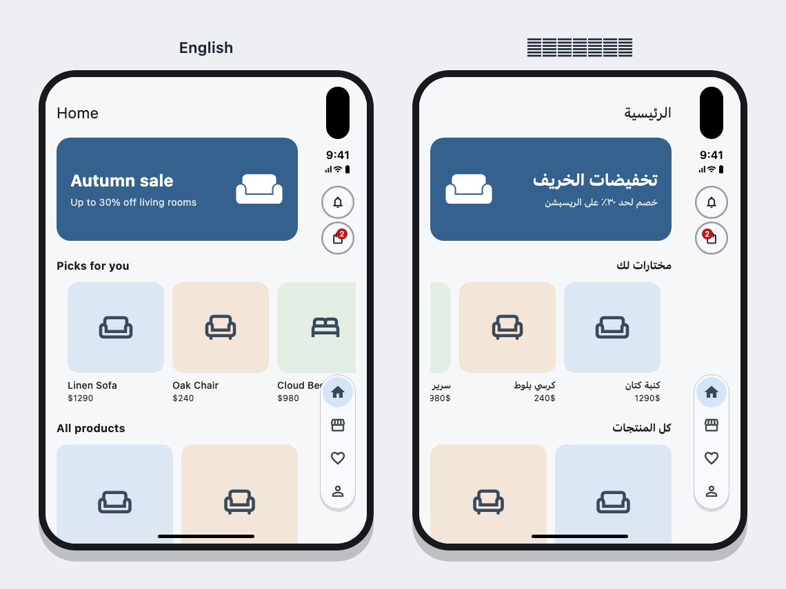

<div dir="rtl">

# duo_layout

**تصميمات الـ iPhone Duo في فلاتر، زي ما Apple بتطلبها بالظبط.**

package واحد بيخلي تطبيقك يتصرف على الـ iPhone Duo زي تطبيقات Apple نفسها:

- شريط التابات يقف على الجنب، ويصغر لما تسكرول.
- أزرار الرجوع والإجراءات تقف في عمود الساعة.
- الشاشة تتقسم نصين على الطيّة بالظبط.
- الصفوف بتسكرول لحد حافة الزجاج.

وفي نفس الوقت **التطبيق نفسه ما بيتغيرش على الآيفون العادي والآيباد**.

[English](README.en.md)


---

## المشكلة اللي بيحلها

الـ iPhone Duo جهاز بيتطوي زي الكتاب. له شاشة برا صغيرة (466×678)، وشاشة جوا كبيرة (669×951) لما يتفتح.

الفرق الكبير عن أي آيفون: **الـ status bar مش فوق، دي نازلة على جنب الشاشة في عمود** (84 نقطة). ده بيحصل على الشاشة اللي برا دايماً، وعلى اللي جوا لما تمسكه بالعرض.

تطبيق متعمل للموبايل العادي، لو اشتغل على الـ Duo من غير أي تعديل:


| من غير الـ package (الشمال) | بالـ package (اليمين) |
|---|---|
| عمود فاضي على اليمين، بيضيع 18% من عرض الشاشة | العمود بقى فيه الأزرار والتابات، زي iOS |
| شريط التابات تحت بياكل من طول الشاشة القصيرة أصلاً | التابات في كبسولة على الجنب، والصفحة أخدت الطول كله |
| أزرار الإشعارات والسلة لازقة جنب الكاميرا | الأزرار تحت الساعة في المكان اللي Apple محدداه |
| صف المنتجات بيقف في نص الشاشة كأنه مقطوع | الصف بيسكرول لحد حافة الزجاج |

ومشاكل تانية ما بتبانش في الصورة:

- **الـ Duo المفتوح بيفضل واقف بالطول وما بيلفش.** iOS بيفضل يبلّغ عن مقاس الشاشة اللي برا حتى والجهاز مفتوح، فأي كود بيقفل الموبايل على الطول بيقفل الـ Duo المفتوح معاه.
- **كل حاجة بتطلع أكبر بـ 15% على الشاشة اللي برا.** ده لو بتستخدم `flutter_screenutil`: بيكبّر على عرض الشاشة كله (466)، مع إن اللي متاح فعلاً للرسم 382 بس.
- **محتوى بيقع على الطيّة نفسها:** نص بيتقطع، أو كارت بيتكسر في النص.
- **مفيش أي معلومة رسمية:** فلاتر ما بيوصلوش أي حاجة عن الـ Duo على iOS، لا مكان الطيّة ولا مكان العمود. الـ package بيستنتج ده من الـ safe area، في مكان واحد.

---

## الفايدة منه

1. **سطر واحد للإعداد،** وبعدها كل widget بتشتغل لوحدها حسب الجهاز.
2. **مفيش `if (isDuo)` في كل شاشة:** الـ widget نفسها بتقرر. على الموبايل `DuoAppBar` هي `AppBar` عادي، وعلى الـ Duo بتحط الأزرار على الجنب.
3. **مكان واحد يتصلح:** الـ Duo جهاز جديد، والاستنتاج من الـ insets ممكن يحتاج تعديل لما Apple تحدّث iOS أو فلاتر يضيف دعم رسمي. التعديل هيبقى هنا، وكل المشاريع تاخده بـ `flutter pub upgrade`.
4. **بيحترم العربي صح:** العمود بيفضل على نفس الجنب الحقيقي من الزجاج في العربي (زي ما Apple بتطلب)، والـ panes هي اللي بتبدّل أماكنها.
5. **متجرّب:** 18 test بتغطي كل widget، ومعاه تطبيق example بيشتغل على الـ simulator.
6. **من غير dependencies:** فلاتر بس. شغال مع `flutter_screenutil` أو من غيره.

---

## فيه إيه

| الـ Widget | بتعمل إيه | تستخدمها فين |
|---|---|---|
| `DuoScope` | بتقرا مكان العمود قبل أي `SafeArea`، وبتسيب مسافة فوق، وبتظبط اتجاهات الدوران | مرة واحدة في `MaterialApp.builder` |
| `SideTabBar` | كبسولة التابات في عمود الـ status bar، وبتصغر مع السكرول | الـ shell اللي فيه التابات |
| `DuoAppBar` | `AppBar` بيحط زرار الرجوع والإجراءات في العمود | بدل `AppBar` في أي شاشة |
| `SideToolbar` و`SideToolbarButton` | نفس فكرة `DuoAppBar` لأي header معمول بإيدك | لو عندك header خاص بيك |
| `TwoPane` | بيقسم الشاشة نصين على الطيّة بالظبط | قائمة جنب تفاصيل، صورة جنب بيانات، سلة جنب الإجمالي |
| `EdgeBleed` | صف أفقي بيسكرول لحد حافة الزجاج | صفوف الكروت والـ chips واللوجوهات |
| `context.barEdge` | العمود على أنهي جنب، أو `null` | لو عايز تقرر حاجة بنفسك |
| `WindowClass` و`DuoBreakpoints` | مقاسات الشاشة، وعدد أعمدة زوجي عشان الطيّة | الـ grids |
| `DuoDesignSize` | مقاس التصميم الصح لـ `flutter_screenutil`، واتجاهات الدوران | لو بتستخدم screenutil |

---

## التركيب

الريبو private، فلازم يكون عندك صلاحية عليه على GitHub. ضيف ده في `pubspec.yaml`:

</div>

```yaml
dependencies:
  duo_layout:
    git:
      url: https://github.com/AbdulrahmanElsehemi/duo_layout.git
      ref: v0.1.0
```

<div dir="rtl">

بعدها شغّل `flutter pub get`.

> **ثبّت `ref` على tag** (زي `v0.1.0`)، عشان أي تعديل جديد في الريبو ما يغيّرش مشروعك فجأة. لما تحب تاخد التحديث، غيّر الـ tag بنفسك.

---

## الإعداد: خطوتين

### 1. `DuoScope` في الـ builder

</div>

```dart
MaterialApp(
  builder: (context, child) => DuoScope(child: child!),
  home: const Shell(),
)
```

<div dir="rtl">

لو عندك builder بالفعل (toasts أو connection banner أو غيره)، خلّي `DuoScope` هو اللي برا خالص:

</div>

```dart
builder: (context, child) => DuoScope(
  child: ToastWrapper(child: child!),
),
```

<div dir="rtl">

`DuoScope` بيعمل 3 حاجات:

- بيقرا مكان العمود من الـ insets الأصلية. أي `SafeArea` في الشاشة بيخفيها عن اللي تحته، عشان كده لازم يتقري من فوق.
- لما العمود يكون على الجنب، iOS بيدي inset فوق = صفر، فالـ headers بتلزق في حافة الزجاج المدورة. عشان كده بيضيف مسافة 24 على الأقل فوق.
- بيقفل الموبايل على الطول، ويسيب الآيباد والـ Duo المفتوح يلفوا براحتهم (`lockPhonesUpright: true`). لو تطبيقك بيظبط الاتجاهات بنفسه، اقفل دي.

### 2. `Info.plist`: الاتجاهات بالعرض

**دي أهم خطوة، ولو نسيتها الـ Duo المفتوح عمره ما هيلف.** الـ Duo بيعتبر نفسه iPhone، وiOS بيعمل تقاطع بين الـ `Info.plist` وبين اللي فلاتر بيطلبه. فلو `Info.plist` فيه Portrait بس، مفيش أي كود هيقدر يلفّه.

في `ios/Runner/Info.plist`:

</div>

```xml
<key>UISupportedInterfaceOrientations</key>
<array>
    <string>UIInterfaceOrientationPortrait</string>
    <string>UIInterfaceOrientationLandscapeLeft</string>
    <string>UIInterfaceOrientationLandscapeRight</string>
</array>
```

<div dir="rtl">

الموبايل العادي هيفضل بالطول، لأن `DuoScope` بيقفله من الكود. بعد التعديل ده لازم build كامل، الـ hot reload مش كفاية.

---

## الاستخدام

### شريط التابات: `SideTabBar`


حط الصفحات جوا `SideTabBar`، وخلّي الـ bottom bar بتاعك يظهر بس لما `SideTabBar.show` تكون `false`:

</div>

```dart
Scaffold(
  body: SideTabBar(
    tabs: const [
      SideTab(icon: Icon(Icons.home_outlined), selectedIcon: Icon(Icons.home), label: 'Home'),
      SideTab(icon: Icon(Icons.storefront_outlined), label: 'Shop'),
      SideTab(icon: Icon(Icons.person_outline), label: 'Profile'),
    ],
    currentIndex: index,
    onTap: (i) => setState(() => index = i),
    child: IndexedStack(index: index, children: pages),
  ),
  bottomNavigationBar: SideTabBar.show(context)
      ? null
      : NavigationBar(/* the bottom bar you already have */),
)
```

<div dir="rtl">

- **أيقونات بس:** العمود ضيق، وApple بتطلب أيقونات من غير كلام. الـ `label` مش بيترسم، بس الـ screen reader بيقراه.
- **بيصغر مع السكرول:** لما تسكرول لتحت، الكبسولة بتصغر للتاب اللي أنت فيه بس، زي iOS بالظبط. لما تسكرول لفوق أو تدوس عليها بترجع تفتح. تقدر تقفل ده بـ `minimizeOnScroll: false`.
- **الشكل:** بياخد ألوانه من الـ `ColorScheme`، أو تحدد ألوانك بـ `style: SideTabBarStyle(...)`.
- **ما بياخدش من طول الصفحة:** الكبسولة مرسومة فوق العمود، والعمود الصفحة سايباه فاضي أصلاً.

### الـ header: `DuoAppBar`

بدل `AppBar`:

</div>

```dart
Scaffold(
  appBar: DuoAppBar(
    title: Text(product.name),
    actions: [
      DuoAction(icon: const Icon(Icons.ios_share), tooltip: 'Share', onPressed: share),
      DuoAction(icon: const Icon(Icons.favorite_border), tooltip: 'Save', onPressed: save),
    ],
  ),
)
```

<div dir="rtl">

- **على الموبايل والآيباد والـ Duo المفتوح بالطول:** `AppBar` عادي بنفس الأزرار.
- **على الـ Duo المقفول أو المفتوح بالعرض:** زرار الرجوع (أو Close في الـ fullscreen dialog) فوق، والإجراءات تحته في العمود تحت الساعة. الـ AppBar نفسه بيفضل فيه العنوان بس، من البداية.
- **الأزرار ماشية مع الشاشة:** بتختفي لما صفحة تانية تغطيها، أو لما التاب بتاعها مش ظاهر، وبتعمل fade مع الـ route.
- **الأزرار اللي فيها كلام** (زي "إلغاء" أو "أضف للحقيبة") ما تحطهاش في `actions`. Apple بتقول الأزرار اللي فيها نص تفضل أفقي، فحطها في الصفحة أو في bottom bar.

لو الـ header بتاعك متعمل بإيدك، استخدم `SideToolbar` مباشرة:

</div>

```dart
Widget build(BuildContext context) {
  final side = SideToolbar.show(context);
  final back = side
      ? SideToolbarButton(icon: const BackButtonIcon(), tooltip: 'Back', onPressed: pop)
      : IconButton(icon: const BackButtonIcon(), onPressed: pop);
  return SideToolbar(
    items: [if (side) back],
    child: MyHeader(leading: side ? null : back, title: title),
  );
}
```

<div dir="rtl">

### نصين على الطيّة: `TwoPane`


</div>

```dart
body: TwoPane.fits(context)
    ? TwoPane(start: ProductList(onPick: pick), end: ProductDetails(picked))
    : ProductList(onPick: (p) => push(ProductPage(p))),
```

<div dir="rtl">

- **مكان القسمة:** بالظبط في نص الشاشة، وده مكان طيّة الـ Duo المفتوح بالعرض. يعني ولا pane بيتكسر، وكل واحد عرضه تقريباً عرض موبايل. على الآيباد هو بس نص ونص.
- **`TwoPane.fits`:** بترجع `true` من عرض 840 وطالع (الـ Duo المفتوح بالعرض، والآيباد بالعرض).
- **الـ insets:** كل pane بيتجنب حافته هو بس، وبياخد الـ insets الخاصة بيها.
- **مين ياخد العمود:** الـ pane اللي جنب العمود بس هو اللي أزراره بتروح للعمود. التاني أزراره بتفضل فوقه، جنب المحتوى اللي بتأثر فيه (قاعدة Apple للـ split view).
- **في العربي:** الـ panes بتبدّل أماكنها، والعمود بيفضل مكانه. في الصورة على اليمين، أزرار المنتج فضلت فوقه في الشريط لأنه بقى بعيد عن العمود.
- **لازم ياخد الشاشة كلها:** iOS ما بيقولش الطيّة فين، فالقسمة معتمدة إن الـ panes واخدين عرض الشاشة كله. حط `TwoPane` في `body` الـ Scaffold، مش جوا حاجة عليها padding.

### صفوف لحد الحافة: `EdgeBleed`

الصفحة بتسيب الـ side insets جوا الـ scroll view بدل ما تلفها في `SafeArea`، والصف بيتلف في `EdgeBleed`:

</div>

```dart
ListView(
  // The page's text keeps clear of the column...
  padding: EdgeBleed.padding(context, const EdgeInsets.all(16)),
  children: [
    const Text('Picks for you'),
    // ...and the row reaches through it to the edge of the glass.
    EdgeBleed(
      child: SizedBox(
        height: 176,
        child: ListView(
          scrollDirection: Axis.horizontal,
          padding: EdgeBleed.padding(context, const EdgeInsets.symmetric(horizontal: 16)),
          children: cards,
        ),
      ),
    ),
  ],
)
```

<div dir="rtl">

- **النتيجة:** أول كارت بيبدأ على نفس خط نص الصفحة، والصف بيسكرول من تحت العمود لحد آخر الزجاج، زي ما بيخرج من حافة أي موبايل.
- **على الموبايل بالطول:** مفيش side insets، فـ `EdgeBleed` بيرجّع الصف زي ما هو.
- **جوا `Column` بتسكرول:** شغال عادي، لأنه بياخد طول الصف بس. `OverflowBox` كان بيبوظ هنا.

### أعمدة زوجية عشان الطيّة


</div>

```dart
final columns = DuoBreakpoints.columns(width, tile: 150, gap: 12, even: true);
```

<div dir="rtl">

Apple بتطلب عدد أعمدة زوجي على الـ Duo، عشان الطيّة تيجي بين عمودين ومتقطعش كارت. `even: true` بتنزّل أي عدد فردي واحد.

### بالعربي



مش محتاج تعمل أي حاجة. العمود حقيقي على الزجاج، فبيفضل على نفس الجنب في العربي (Apple بتطلب كده). المحتوى بيتعكس عادي.

### مع `flutter_screenutil`

لو التصميم معمول على frame موبايل (390×844 مثلاً)، استخدم `DuoDesignSize.forWindow` بدل الـ `designSize` الثابت:

- **الشاشة اللي برا:** بيكبّر على العرض اللي جنب العمود، فمفيش تكبير زيادة 15%.
- **الآيباد والـ Duo المفتوح:** بيرسم نقط التصميم زي ما هي، والشاشة بتعرض حاجات أكتر في الصف بدل ما الموبايل يتنفخ.
- **لما الجهاز يتفتح أو يتقفل:** المقاس بيتحسب تاني من غير ما التطبيق يتبني من الأول. الفورم اللي نصها متملي واللسته اللي متسكرولة بيفضلوا زي ما هما.

</div>

```dart
class WindowScreenUtil extends StatefulWidget {
  const WindowScreenUtil({super.key, required this.child});
  final Widget child;
  @override
  State<WindowScreenUtil> createState() => _WindowScreenUtilState();
}

class _WindowScreenUtilState extends State<WindowScreenUtil>
    with WidgetsBindingObserver {
  Size? _design;

  @override
  void initState() {
    super.initState();
    WidgetsBinding.instance.addObserver(this);
  }

  @override
  void dispose() {
    WidgetsBinding.instance.removeObserver(this);
    super.dispose();
  }

  Size _designOf(BuildContext context) {
    final view = View.of(context);
    return DuoDesignSize.forWindow(
      view.physicalSize / view.devicePixelRatio,
      phoneFrame: const Size(390, 844), // your Figma frame
      insets: EdgeInsets.fromViewPadding(view.padding, view.devicePixelRatio),
    );
  }

  @override
  void didChangeMetrics() {
    if (_designOf(context) == _design) return; // the keyboard, not a resize
    setState(() {});
    // ScreenUtilInit rebuilds only public widgets; rebuild them all.
    void rebuild(Element e) => e..markNeedsBuild()..visitChildren(rebuild);
    (context as Element).visitChildren(rebuild);
  }

  @override
  Widget build(BuildContext context) => ScreenUtilInit(
        designSize: _design = _designOf(context),
        minTextAdapt: false,
        splitScreenMode: true,
        child: widget.child,
      );
}
```

<div dir="rtl">

وحط `WindowScreenUtil` مكان `ScreenUtilInit` فوق الـ `MaterialApp`.

---

## إزاي بيعرف إنه على الـ Duo

فلاتر على iOS **ما بيوصلوش أي معلومة** عن الـ Duo: لا `displayFeatures`، ولا مكان الطيّة، ولا مكان العمود. فالـ package بيستنتج من الـ safe area:

> لو inset جنب واحد أكبر من الـ inset اللي فوق، والجنب التاني صفر، يبقى الـ status bar نازل على الجنب ده.

| الجهاز | الـ insets | النتيجة |
|---|---|---|
| iPhone بالطول | top 47، bottom 34 | `null`: bars عادية |
| iPhone بالعرض | left 47، right 47 | `null`: الجنبين متساويين (notch وحواف) |
| iPad | top 24، bottom 20 | `null` |
| Duo مفتوح بالطول | top، bottom | `null`: bars عادية، زي ما Apple بتقول |
| Duo مقفول (466×678) | right 84، bottom 34 | `BarEdge.right` |
| Duo مفتوح بالعرض (951×669) | right 84، bottom 34 | `BarEdge.right` |

ده كله في `BarEdge.of` في ملف واحد. لو Apple غيرت الأرقام، أو فلاتر ضاف API رسمي، التعديل هيبقى هناك بس.

### قواعد Apple اللي الـ package ماشي عليها

من [Designing for iPhone Duo](https://developer.apple.com/design/human-interface-guidelines/designing-for-iphone-duo):

- **مكان العمود:** الـ tab bar والـ toolbar وزرار الرجوع بيقفوا في عمود الـ status bar، على الشاشة اللي برا دايماً، وعلى اللي جوا بالعرض. جوا بالطول الـ bars بتفضل أفقي.
- **الترتيب:** الرجوع أو الإغلاق فوق، بعده الإجراءات، والتابات تحت في كبسولة أيقونات.
- **في اللغات اللي من اليمين:** العمود بيفضل على نفس الجنب الحقيقي من الزجاج.
- **لما الصفحة تسكرول:** شريط التابات بيصغر.
- **الأزرار اللي فيها نص** بتفضل في bars أفقية.
- **في الـ split view:** الـ pane اللي جنب العمود بس هو اللي بيدّي أزراره للعمود.
- **مع الطيّة:** أعمدة زوجية، ومفيش إعادة ترتيب كبيرة لما الجهاز يتطوي أو يتفتح.

---

## حدود لازم تعرفها

- **مكان أول زرار في العمود** (`SideToolbar.defaultTop`): 160 على الشاشة اللي برا و104 جوا. iOS ما بيديش رقم، فدول متقاسين على الـ simulator (iOS 27.1). لو اختلفوا على الجهاز الحقيقي، عدّلهم بـ `top:`.
- **وضع "نص مفتوح" زي اللابتوب:** مش مدعوم، لأن فلاتر ما بيعرفش زاوية الفتح على iOS.
- **قائمة "…" للأزرار اللي مش لاقية مكان في العمود:** لسه مش موجودة. حط في العمود 3 أزرار أو 4 بالكتير.
- **أندرويد:** الـ foldables على أندرويد ما عندهاش عمود جانبي، فـ `barEdge` بيبقى `null` والتطبيق بيتصرف عادي. `TwoPane` و`WindowClass` شغالين على أي شاشة عريضة.

---

## جرّبه

</div>

```bash
cd example
flutter run -d "iPhone Duo"
```

<div dir="rtl">

- **تقفل وتفتح الجهاز:** من الـ Simulator نفسه.
- **تلف الجهاز:** بـ ⌘← أو ⌘→.

تشغيل الـ tests:

</div>

```bash
flutter test
```

<div dir="rtl">

### الصور اللي في الـ README

الصور مرسومة من تطبيق الـ example في frames، ومتولّدة بـ golden tests. لو غيّرت حاجة في الشكل، ولّدها تاني:

</div>

```bash
cd example
flutter test test/screenshots_test.dart --update-goldens
```

<div dir="rtl">

لازم تتولّد على Mac، لأنها بتحمّل خط San Francisco من macOS.

---

## الخطوات الجاية

- [ ] قائمة "…" للأزرار اللي مش لاقية مكان في العمود
- [ ] الصور الكبيرة (hero) تكمل لحد تحت العمود
- [ ] استبدال الاستنتاج من الـ insets بـ API رسمي، أول ما فلاتر يوفّره

</div>
